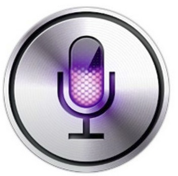

# Hebrew Speech Recognition on iPad

  

A documentation record of an iPad speech-recognition project for Hebrew dictation.

Students: Nadav Merlis, Liora Neeman.

Supervision: Aaron Wetzler.

## Available materials

This repository contains the archived project description, credits and microphone thumbnail. The historical project concerned an iPad application for Hebrew dictation. The archived description credits the underlying research to Prof. Koby Kramer (as spelled in the archived description), but provides no paper or implementation identifying the method.

No application source, executable, report, training data, model or build configuration has been recovered for publication here. The description alone does not establish the recognition method, supported vocabulary, model training procedure or error rate.

## Use and validation

There is no software to install or run from this repository. The iPad platform badge records the intended historical platform; it does not identify a tested iOS version or current device support. No recognition evaluation, training run or application build has been performed during recovery. The website link below is the available project record.

## Links

- [Project entry on Aaron Wetzler's website](https://twerdster.github.io/#hebrew-speech-recognition-on-ipad)

## Attribution and reuse

The credits above follow the archived project page. No license for unrecovered source code is implied by this README. Original authors can open an issue to contribute updates or request corrections or removal of their material.

Figure provenance: `assets/project-preview.jpg` is the thumbnail used for this project on the archived project page of Aaron Wetzler's website, copied without modification. It is a microphone icon, not a screenshot of the student application; its original creator was not recorded in the archive, and it remains the property of its owner.
