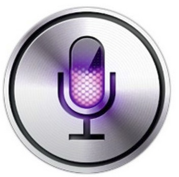

# Hebrew Speech Recognition on iPad

This student project explored Hebrew dictation on an iPad. The surviving description records its purpose and credits, but does not establish its recognition model, training method or error rate.

Original project: **Nadav Merlis and Liora Neeman**. Supervision: **Aaron Wetzler**.

*Historical project thumbnail; its creator was not recorded. It is not an application screenshot.*

The archived description and thumbnail are preserved. No original application, recognizer, report or executable has been recovered.

## Updated

**[Open the browser demo](https://twerdster.github.io/hebrew-speech-ipad/)** · [Updated guide](updated/README.md)

The new interface provides right-to-left editing, a newly written sample and UTF-8 export. Optional dictation uses the browser’s speech service; audio may be processed by the vendor. It is not the students’ recognizer and does not demonstrate their unknown method. Editing/export were checked in Chrome; live recognition and physical iPad use remain untested.

[Browser controls, local serving and limitations](updated/demo/README.md)

## Project record and rights

[Historical context, attribution and recovery details](PROJECT_RECORD.md) preserve the earlier record. Original material, datasets, dependencies and new code keep their separately stated terms; no blanket license is added.
