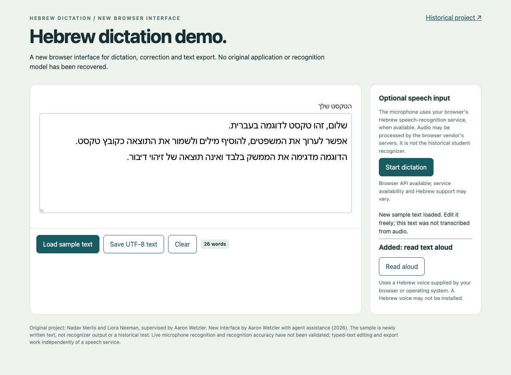

# Hebrew Speech Recognition on iPad: updated work

## Updated work

**[Open the browser demo](https://twerdster.github.io/hebrew-speech-ipad/)**

A **new browser interface demonstration** supports right-to-left text editing and UTF-8 export. Optional dictation uses the browser's speech service, when available; audio may be processed by the browser vendor. This is not the historical recognizer. The supplied text is an editable example, not recognition output.

[Browser demo guide](demo/README.md) describes local use, checks and limitations.

Historical project: Nadav Merlis and Liora Neeman; supervision: Aaron Wetzler. New implementations are labeled separately and do not change the preserved materials.

*Actual Chrome interface capture. Its input and execution scope are described above and in the demo guide.*
